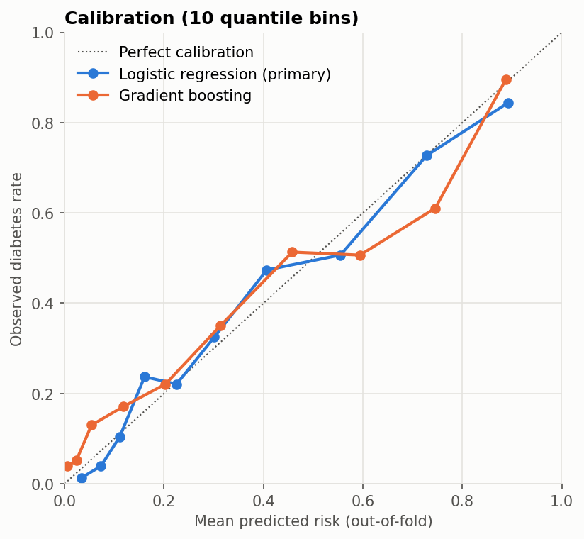

# Type 2 Diabetes Risk Model (Pima Indians Diabetes Data)

A leakage-free, calibrated risk model for diabetes in 768 Pima Indian women. It handles the dataset's impossible zero values, compares logistic regression with a linear SVM and gradient boosting under repeated cross-validation, and reports clinically relevant operating points and adjusted odds ratios.

Reproduced by [`notebooks/diabetes_risk_model.ipynb`](notebooks/diabetes_risk_model.ipynb).

> Research and education only. This isn't a clinical screening tool.

## Results

**Discrimination and overall accuracy** (stratified 5-fold CV ×20; imputation and scaling fit inside folds):

| Model | ROC-AUC (95% CI) | PR-AUC | Brier | Accuracy @0.5 |
|---|---|---|---|---|
| **Logistic regression (primary)** | **0.832** (0.807–0.864) | 0.708 | 0.158 | 0.771 |
| Linear SVM (original model family) | 0.835 (0.807–0.865) | 0.713 | 0.156 | 0.772 |
| Gradient boosting | 0.826 (0.793–0.853) | 0.690 | 0.162 | 0.759 |

Baselines: Brier 0.227 for predicting the 34.9% prevalence for everyone; accuracy 0.651 for always predicting "no diabetes". **Model complexity doesn't help.**

**Operating points** (logistic regression, held-out women, mean of 20 repeats):

| | Sensitivity | Specificity | PPV | NPV |
|---|---|---|---|---|
| Threshold 0.5 | 0.572 | 0.878 | 0.716 | 0.793 |
| Threshold set in training folds for 85% sensitivity | **0.853** | 0.626 | 0.550 | **0.888** |

At the default threshold the model misses **43% of women with diabetes**. The earlier version's 77% accuracy figure hid this. For screening, the sensitivity-targeted threshold met its target on unseen data.



**Adjusted odds ratios per SD** (n = 724 complete cases; insulin and skinfold excluded for missingness): glucose 2.95 (2.38–3.67), BMI 1.87 (1.51–2.31), pregnancies 1.49 (1.19–1.85), diabetes pedigree 1.38 (1.13–1.68), age 1.22 (0.97–1.53), diastolic BP 0.90 (0.73–1.10). A four-variable model (glucose, BMI, age, pedigree) reaches ROC-AUC 0.827.

## Methods

- **Zeros are missing values:** Glucose (5), BloodPressure (35), SkinThickness (227), Insulin (374) and BMI (11) zeros are converted to missing, then median-imputed with missingness indicators **inside each training fold**.
- **Validation:** repeated stratified CV with out-of-fold probabilities, percentile bootstrap CIs, Brier score and a calibration curve.
- **Threshold selection:** a threshold for 85% sensitivity is chosen by inner CV on each training fold and applied unchanged to the test fold.

## Limitations

- **One specific population** (Pima Indian women aged 21 or older), with no external validation.
- **`Glucose` is the 2-hour oral glucose tolerance test value**, which is part of the diagnostic criterion, so this is closer to diagnostic classification than to predicting future diabetes.
- Insulin is missing for 49% of women and skinfold for 30%. Multiple imputation would be more rigorous than median imputation.

## Reproduce

```bash
python -m venv .venv
.venv\Scripts\activate            # macOS/Linux: source .venv/bin/activate
pip install -r requirements.txt
pytest
jupyter nbconvert --to notebook --execute --inplace notebooks/diabetes_risk_model.ipynb
```

Data comes from OpenML (dataset 37, licence "Public") and is included with checksums; see [`data/README.md`](data/README.md). Tested with Python 3.13. Notebook runtime is about 2 minutes on a laptop (nested threshold selection for three models × 20 repeats).

## Changes from the earlier version

The previous notebook:
- kept impossible zeros as real values;
- fit the scaler on all data before splitting;
- reported only single-split accuracy;
- gave a hand-drawn "Key Predictors" bar chart that no analysis produced;
- showed an MIT badge without a LICENSE file.

All of this has been replaced with the analysis above. The repository name keeps its original spelling (`Diabtetes`) because renaming is a separate decision. GitHub redirects old URLs after a rename.

## Author

Prince Kwarteng Amaning. MS Data Science, University of Michigan–Dearborn. Background in dentistry and public health.

License: MIT (code). Data: Pima Indians Diabetes Database (NIDDK), via OpenML.
